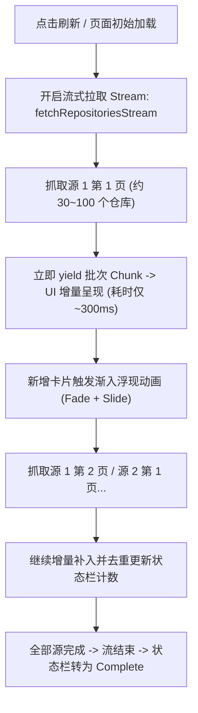

# 0.6.3-beta.4+20261113：流式增量加载、新增动画、默认系统代理与数据源管理规划

## 一、 背景与现有机制分析

### 1.1 为什么当前 UI 上找不到“增加 Source”入口？
在查阅 [`lib/pages/page3_adaptive_grid.dart`](file:///D:/aaaStuffsaaa/from_git/github/dart-flutter-demo/lib/pages/page3_adaptive_grid.dart) 的代码后发现：
- 当前 `_buildSourceTable` 中，只实现了基于 `_sourceControllers` 长度生成的 `DataRow` 列表；
- 每一行的末尾仅绑定了 `_removeSource(index)`（垃圾桶图标按钮）；
- **当时未在表格底部或操作栏中放置 `_addSource()` 按钮**，导致用户无法在界面上动态追加自定义的 GitHub 用户或组织 URL。

### 1.2 为什么需要默认选中“系统代理”？
- `0.6.2-beta.3` 中引入了 Firefox 经典三态代理，初始值硬编码为了 `ProxyMode.manual`（手动代理）；
- 对于大部分日常使用环境（以及没有开启 7890 端口代理的机器），默认跟随操作系统的系统代理（`ProxyMode.system`）是最通用、省心且不会造成误断网的选择。

### 1.3 现有加载瓶颈与流式加载可行性
- **现状**：`fetchRepositories` 采用的是单次 `Future` 返回。系统必须逐一分页请求全部数据源（最多可达数十次 HTTP 调用），等到最后一个数据源拉取完毕、所有分页去重后，才一次性通知 UI；
- **痛点**：在此期间界面只能显示全屏居中的 `Loading...` 骨架圈，等待时间长，体验僵硬；
- **可行性**：**完全可行且效果极佳**。采用 Dart 的 `Stream`（异步生成器 `async*`）分片机制，每当某一个数据源的某一页（例如首批 30~100 个仓库）解析成功，立即通过 Stream 吐出，UI 层立即渲染并触发新增入场动效，后续仓库如流水般自然补入。

---

## 二、 核心改造规划与技术方案



### 2.1 默认代理切换为“系统代理”
- **文件**：[`lib/services/network_proxy_service.dart`](file:///D:/aaaStuffsaaa/from_git/github/dart-flutter-demo/lib/services/network_proxy_service.dart)
- **修改**：
  ```dart
  // 将默认模式设为系统代理
  final ValueNotifier<ProxyMode> modeNotifier =
      ValueNotifier<ProxyMode>(ProxyMode.system);
  ```

### 2.2 增加 Source 的 UI 交互设计
- **文件**：[`lib/pages/page3_adaptive_grid.dart`](file:///D:/aaaStuffsaaa/from_git/github/dart-flutter-demo/lib/pages/page3_adaptive_grid.dart)
- **改进点**：
  1. **表格底部添加“+ 添加数据源”动作行**：
     - 提供一个醒目的 OutlinedButton / TextButton：“+ 添加 GitHub 数据源”；
     - 点击后向 `_sourceControllers` 新增一个空控制器，光标自动聚焦新输入框；
  2. **内置快速预置按钮**：
     - 提供一键恢复预设或快捷填入预设按钮（如 `+ 导入 VincentZyuLive`）；
  3. **默认数据源扩充至 3 个**：
     - 包含个人号：`https://github.com/VincentZyu233?tab=repositories`
     - 包含组织号：`https://github.com/orgs/VincentZyuApps/repositories`
     - 包含新增 Live 号：`https://github.com/VincentZyuLive?tab=repositories`

### 2.3 流式增量加载（Stream Architecture）
- **文件**：[`lib/services/github_repository_service.dart`](file:///D:/aaaStuffsaaa/from_git/github/dart-flutter-demo/lib/services/github_repository_service.dart)
- **数据结构设计**：
  ```dart
  class GitHubRepositoryChunk {
    final List<GitHubRepositoryItem> newItems; // 本批次拉取到的新仓库
    final String currentSourceLabel;          // 当前抓取的数据源标签
    final int page;                           // 当前页码
    final bool isFinished;                    // 是否全流程已完毕
    final String log;                         // 进度日志
  }
  ```
- **Service 层 API**：
  ```dart
  Stream<GitHubRepositoryChunk> fetchRepositoriesStream({
    required List<String> sourceUrls,
    bool? useProxy,
    String? proxyUrl,
  }) async* { ... }
  ```
  每当 HTTP 获取并反序列化出一页数据，立即 `yield` 给 UI。

### 2.4 新增卡片动效与瀑布流平滑上浮
- **现有优势**：[`RepositoryCard`](file:///D:/aaaStuffsaaa/from_git/github/dart-flutter-demo/lib/widgets/repository_card.dart) 内部已经自带了 `TweenAnimationBuilder` 的位移和透明度渐变；
- **增量挂载关键**：
  1. 给每个渲染项分配明确的 `Key(repo.id)`，确保 Flutter 在 Widget 树 diff 时识别出哪个是既有项、哪个是新增项；
  2. 针对新涌入的批次，动态赋予入场 stagger delay（例如批次内的 index * 40ms），形成波浪式平滑涌入的视觉盛宴；
  3. 顶部信息条实时同步：
     `⚡ 正在流式接收 @VincentZyuLive (第 1 页)... 已呈现 180 个仓库` -> `⚡ 流式接收完毕，共 340 个仓库`。

### 2.5 Page 大小动态配置 (页面级可调，默认 25，范围 1~999)
- **UI 布局**：在 Configuration 折叠控制栏（与 Columns/Layout/Sort 并列）增加 **Page Size** 数字微调控件；
- **数值规则**：
  - **默认值 (Default)**：`25`（4 列下正好排 6 行 + 1 张，完美铺满整整一个屏幕的视野，轻快灵动）
  - **最小值 (Min)**：`1`
  - **最大值 (Max)**：`999`
  - **步长 (Step)**：`1`（支持输入框直接编辑或 `+` / `-` 步进）
- **底工程映射逻辑**：
  - GitHub REST API 官方单次上限为 `100`；
  - 当设定值在 `[1, 100]` 时：直接将 API 的 `per_page` 设为该值，严格按设定步长（如 25）流式吐出；
  - 当设定值在 `[101, 999]` 时：底层按 GitHub 接口最大 100 自动多页拼包，累积到用户期望的大小后再 yield 到 UI，确保无论设多大都能完全符合用户预期的节奏。

---

## 三、 修改文件清单与影响面

| 文件 | 修改性质 | 核心职责 |
| :--- | :--- | :--- |
| `lib/services/network_proxy_service.dart` | 默认值修改 | 默认模式调整为 `ProxyMode.system` |
| `lib/services/github_repository_service.dart` | 特性扩展 | 新增 `fetchRepositoriesStream` 异步流生成器 |
| `lib/pages/page3_adaptive_grid.dart` | UI 与状态重构 | 增加 Source 按钮、默认 3 数据源、接入流式刷新与增量入场动效 |
| `pubspec.yaml` & `application_version.dart` | 版本升级 | 升级至 `0.6.3-beta.4+20261113` |
| `test/services/github_repository_service_test.dart` | 单元测试 | 针对流式生成器与数据源解析添加测试用例 |

---

## 四、 本轮结论
- 本轮调研与规划完成，不触发代码修改与 CI 构建；
- 确认全部功能技术可行、路径明确，待下一轮指令即可完整落地。
