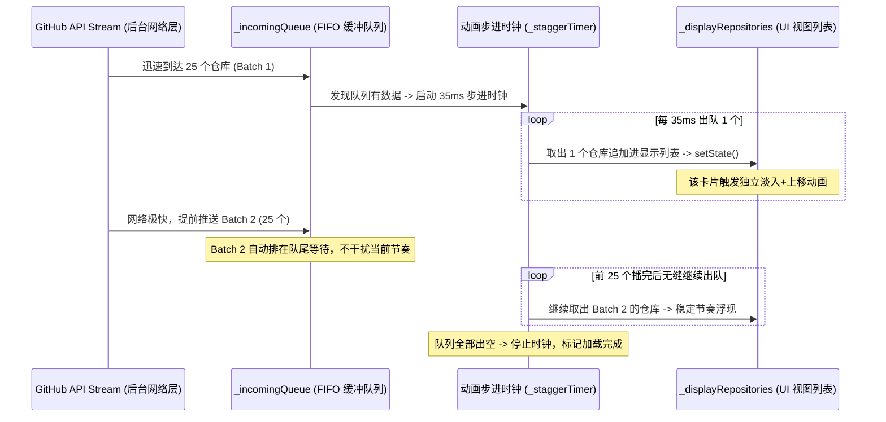

# 0.6.4-beta.5+20261113：步进出队动画调度器与 GitHub Linguist 语言色彩调研规划

## 一、 为什么 beta.4 中依然是“全部加载完才显示”？（根因排查）

在细致检查 [`lib/pages/page3_adaptive_grid.dart`](file:///D:/aaaStuffsaaa/from_git/github/dart-flutter-demo/lib/pages/page3_adaptive_grid.dart#L203-L212) 的视图层逻辑后，发现了导致该现象的绝对根因：

```dart
// 当前问题代码 (lib/pages/page3_adaptive_grid.dart:203)
AnimatedSwitcher(
  duration: const Duration(milliseconds: 300),
  transitionBuilder: _animatedTransitionBuilder,
  child: _loading // ⚠️ 致命拦截点！
      ? _buildLoadingState(key: const ValueKey('loading'))
      : filtered.isEmpty
          ? _buildEmptyState(key: const ValueKey('empty'))
          : SizedBox(...) // 卡片网格在这里
)
```

- **问题分析**：
  在 `_refresh()` 运行期间，`_loading` 始终为 `true`。虽然底层的 `Stream` 已经一页一页（每 25 个）持续把数据 `yield` 出来并触发了 `setState`，但顶部的 `AnimatedSwitcher` 因为判断了 `child: _loading ? _buildLoadingState() : ...`，导致整片卡片区域**被死死遮蔽在转圈骨架屏下方**！
  直到最后所有源的所有分页全部跑完、进入 `finally { _loading = false; }` 的瞬间，`AnimatedSwitcher` 才突然放行，结果就是用户看到的“等全部跑完之后砰的一下全出来”。
- **修复方案**：
  必须将其修改为：
  ```dart
  child: (_loading && _repositories.isEmpty)
      ? _buildLoadingState(key: const ValueKey('loading'))
      : filtered.isEmpty
          ? _buildEmptyState(key: const ValueKey('empty'))
          : SizedBox(...)
  ```
  只要收到第 1 批数据（列表不为空），网格区域立刻解除遮蔽，立即展现！

---

## 二、 “排队步进式错开动画引擎 (Stagger Queue Scheduler)”方案设计

用户提出的动画核心诉求：
1. **不要一瞬间全弹出来**：25 个卡片也不要“齐刷刷同时出现”，而是像发牌或流水一样，一个接一个错开浮现；
2. **后端拉取极快时自动排队**：如果网络极快，前 25 个动画还在逐个播，下一批 25 个又到了，**后来的数据必须在队列里排队，等前面的动画播完再依次出现**，不能乱成一团。



### 2.1 架构核心变量设计
在 `_Page3AdaptiveGridState` 中引入双列表队列体系：
- `final List<GitHubRepositoryItem> _displayRepositories = []`: 真正绑定在 UI 树上渲染的卡片列表；
- `final List<GitHubRepositoryItem> _incomingQueue = []`: 网络拉取到的待播队列（FIFO）；
- `Timer? _staggerTimer`: 动画步进抽取定时器。

### 2.2 自适应节奏出队算法
- **基础节奏**：设定每 `35ms ~ 45ms` 抽取 1 个仓库压入 `_displayRepositories`；
- **自适应缓冲保护**：
  - 当 `_incomingQueue.length < 30` 时：保持 `40ms` 优雅从容步进；
  - 当 `_incomingQueue.length > 60` 时（数据积压过多）：动态提速至 `20ms` 快速出队，防止用户等太久；
- **状态流转**：
  - 用户可以清晰看到左上角或者顶部状态条显示：`正在流畅呈现: 42 / 228 仓库...`，视觉反馈极具仪式感和生命力！

---

## 三、 GitHub 官方 Linguist 语言颜色与 Dot 标记调研

用户诉求：每个仓库卡片增加一个 **Dot 圆点颜色 + 主语言标记**（类似 GitHub 官网卡片），且**本地不硬编码颜色表，而是从 GitHub 实时获取**。

### 3.1 官方数据源调研
- GitHub 官方的编程语言名称、颜色与语法高亮统一定义在官方开源仓库：
  `https://raw.githubusercontent.com/github-linguist/linguist/master/lib/linguist/languages.yml`；
- 社区高可用、高压缩的 JSON 格式标准源（被多数 GitHub 插件和第三方客户端采用）：
  `https://raw.githubusercontent.com/ozh/github-colors/master/colors.json`（体积仅 ~25KB，纯净键值对，包含所有 500+ 语言的 Hex 颜色，如 `"Dart": {"color": "#00B4AB"}, "Python": {"color": "#3572A5"}`）。

### 3.2 架构实现（LinguistColorService）
创建 [`lib/services/linguist_color_service.dart`](file:///D:/aaaStuffsaaa/from_git/github/dart-flutter-demo/lib/services/linguist_color_service.dart)：
1. **远程实时获取**：
   - 应用启动或进入 Page 3 时，异步请求该 JSON（自动借力已落地的全局代理 `NetworkProxyService`）；
   - 解析后将 `Map<String, Color>` 缓存在内存中；
2. **极速三级容灾（无网/冷门语言）**：
   - **第一级（远程字典）**：若远程获取成功，直接取官方精确颜色；
   - **第二级（常用兜底）**：若无网或尚未加载完成，内置一份极小字典（常见 20 种：Dart、Python、C++、JS、TS、Rust、Go、Java、HTML 等）；
   - **第三级（哈希推导算法）**：对于罕见小众语言，用语言名称计算稳定的 Hash 映射到 HSL 色彩空间（`HSLColor.fromAHSL(1.0, hash % 360, 0.65, 0.55)`），确保任何冷门语言都能拥有专属、稳定且美观的圆点颜色，绝对零报错。

### 3.3 UI 视觉设计（GitHub 经典风格）
在 `RepositoryCard`（卡片）与 `RepositoryListTile`（列表项）中嵌入：
```dart
if (repo.language != null && repo.language!.isNotEmpty)
  Row(
    mainAxisSize: MainAxisSize.min,
    children: [
      Container(
        width: 10,
        height: 10,
        decoration: BoxDecoration(
          color: LinguistColorService.instance.getColor(repo.language!),
          shape: BoxShape.circle,
        ),
      ),
      const SizedBox(width: 5),
      Text(
        repo.language!,
        style: theme.textTheme.bodySmall?.copyWith(
          color: theme.colorScheme.onSurfaceVariant,
          fontWeight: FontWeight.w600,
        ),
      ),
    ],
  )
```

---

## 四、 规划实施清单（0.6.4-beta.5+20261113）

| 模块 | 文件 | 变动说明 |
| :--- | :--- | :--- |
| **视图层修复** | `lib/pages/page3_adaptive_grid.dart` | 修复 `AnimatedSwitcher` 中 `_loading` 遮蔽问题，列表有数据时即刻解封渲染 |
| **动画调度引擎** | `lib/pages/page3_adaptive_grid.dart` | 引入 `_incomingQueue` 与 `_staggerTimer`，实现逐个步进出队与超速排队等待动效 |
| **色彩服务** | `lib/services/linguist_color_service.dart` | 新增单例，从 GitHub 实时获取语言色彩表，配有本地常用兜底与 HSL 哈希推导 |
| **卡片/列表组件** | `lib/widgets/repository_card.dart` & `repository_list_tile.dart` | 接入 Linguist 语言彩色 Dot 圆点与语言徽标 |
| **版本同步** | `pubspec.yaml` & `application_version.dart` | 升级至 `0.6.4-beta.5+20261113` |
| **测试套件** | `test/linguist_color_service_test.dart` | 验证色彩解析、兜底机制及哈希稳定性 |

---

## 五、 本轮结论
- 本轮调研规划完成，已准确定位了“未分批出现”的真正代码阻塞点；
- 逐个错开出队动画与 GitHub Linguist 远程颜色机制均成熟可靠，逻辑严丝合缝；
- 下一轮可立即进行代码实装。
