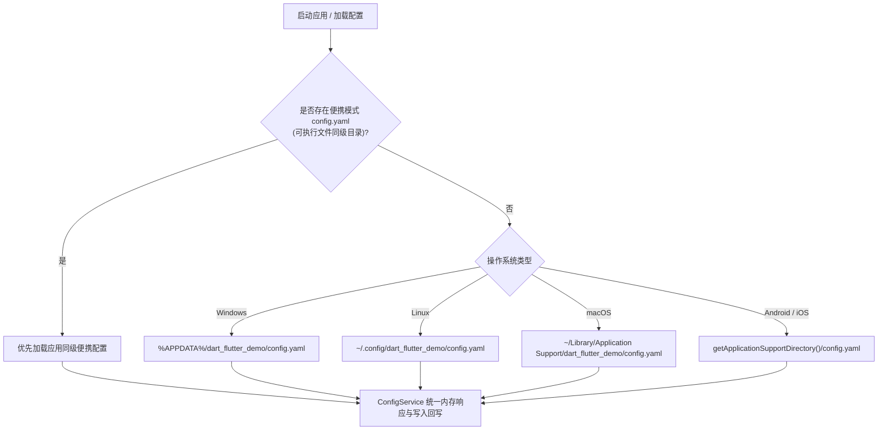

# 0.6.5-beta.6+20261113：全平台 YAML 持久化配置、GitHub Token 鉴权与向导规划

## 一、 背景与痛点：403 / 429 API Rate Limit 深度剖析

在 `0.6.4-beta.5` 运行过程中，用户在加载 3 个数据源时触发了 GitHub API 报错：
```text
HttpException: GitHub API request failed (403) for VincentZyuLive: 
{"message":"API rate limit exceeded for 31.58.133.175. (But here's the good news: Authenticated requests get a higher rate limit. Check out the documentation for more details.)"}
```

- **未认证请求限制**：GitHub REST API 对匿名 IP 的频次限制仅为 **60 次/小时/IP**。当配置了 3 个数据源、每个源包含数页时，用户点 2~3 次刷新就会迅速耗尽匿名额度；
- **认证后额度暴增**：一旦在请求头中携带 GitHub Personal Access Token（`Authorization: Bearer <TOKEN>`），配额立即飙升至 **5,000 次/小时**，彻底告别 403/429 报错；
- **安全与权限关键点**：由于本应用仅抓取公开公开仓库（Public Repositories），该 Token **甚至不需要勾选任何私有写入权限**（勾选 `public_repo` 或全不勾选均可），对用户账号极其安全。

---

## 二、 优秀先例与参考项目深度调研

### 2.1 调研一：Lazer 的全平台存储模型与路径行为
在深入查阅 [`D:\aaaStuffsaaa\from_git\github\Lazer\lib\storage\app_storage_io.dart`](file:///D:/aaaStuffsaaa/from_git/github/Lazer/lib/storage/app_storage_io.dart) 后，归纳出其跨平台路径架构：

| 平台 | Lazer 行为与标准路径规范 | 推荐落地点（本应用适配） | 读写权限与特性 |
| :--- | :--- | :--- | :--- |
| **Windows** | `%APPDATA%\<app>` 或标准应用目录，优先检查便携式 | `%APPDATA%\dart_flutter_demo\config.yaml` 或便携同级目录 | 无需管理员权限，漫游漫入，便携友好 |
| **Linux** | `$XDG_CONFIG_HOME/<app>`，回退至 `~/.config/<app>` | `~/.config/dart_flutter_demo/config.yaml` | 严格符合 Linux XDG 桌面规范，Flatpak 兼容 |
| **macOS** | `~/Library/Application Support/<app>` | `~/Library/Application Support/dart_flutter_demo/config.yaml` | 符合 Apple 沙盒规范与 App Store 审计 |
| **Android** | 支持外部路径调度迁移，默认应用私有存储 | `getApplicationSupportDirectory()` -> `/data/user/0/.../files/config.yaml` | 沙盒隔离，卸载自动清除，安全无侵入 |
| **iOS** | 私有沙盒 `Library/Application Support` | `getApplicationSupportDirectory()` -> `<AppHome>/Library/Application Support/config.yaml` | 严格沙盒，防 iCloud 冗余同步备份 |

### 2.2 调研二：`git-repo-monitor` 的 Token 指导设计
在查阅 [`G:\GGames\Minecraft\shuyeyun\qq-bot\koishi-dev\koishi-dev-8\external\git-repo-monitor\src\config.ts`](file:///G:/GGames/Minecraft/shuyeyun/qq-bot/koishi-dev/koishi-dev-8/external/git-repo-monitor/src/config.ts#L583-L598) 后，提炼出成熟的 Token 获取说明体系：
1. **明确说明配额反差**：未配置 60 次/小时 -> 配置后 5,000 次/小时；
2. **清晰指引 Classic 令牌**：Settings -> Developer settings -> Personal access tokens (classic)；
3. **权限最小化声明**：仅勾选 `public_repo`（只读公开仓库），不泄露私有数据；
4. **一键直达专属 URL**：`https://github.com/settings/tokens/new?description=DartFlutterDemo&scopes=public_repo`，可直接通过 URL 参数预填 Token 描述与只读权限。

---

## 三、 配置持久化结构与变种方案对比

采用 Dart 原生 `yaml` / `yaml_edit` 库进行解析与无损覆写。

### 3.1 YAML 配置文件结构设计
```yaml
# DartFlutterDemo 全局配置文件
version: 1

appearance:
  theme_mode: system           # system | light | dark
  font_family: system          # 10 款精选字族枚举 ID

network:
  proxy_mode: system           # direct | system | manual
  manual_proxy_url: "http://127.0.0.1:7890"

performance:
  enable_lazer_hud: false
  detailed_lazer_hud: true

github:
  token: ""                    # 用户配置的 Personal Access Token
  sources:
    - "https://github.com/VincentZyu233?tab=repositories"
    - "https://github.com/orgs/VincentZyuApps/repositories"
    - "https://github.com/VincentZyuLive?tab=repositories"
```

### 3.2 变种方案一：持久化字段与 UI 归属位置（用户重点考虑项）

用户提议：**“要不要所有需要持久化的字段都放到全局设置悬浮窗（SettingsDialog），其他的非持久化临时调整留在页面？（即 source 和 proxy 只在全局设置里出现）”**

| 方案 | 架构描述 | 优势 | 劣势 | 推荐指数 |
| :--- | :--- | :--- | :--- | :--- |
| **方案 A<br/>（强烈推荐：全局统一设置 + 页面直达徽章）** | **所有持久化字段均归口在 `SettingsDialog`**（主题、字体、代理、HUD、Token、Sources 列表）。Page 3 控制栏彻底精简，只留临时过滤/排序/列数/PageSize；并在 Page 3 保留一个轻量徽标与一键直达“设置”弹窗的按钮。 | **职责边界极度清晰**：需要存盘的全在 SettingsDialog，单点配置、处处生效；Page 3 彻底摆脱复杂的 URL 表格与代理配置，清爽大气！ | 在 Page 3 增删源需点一次“设置”呼出弹窗 | ⭐⭐⭐⭐⭐<br/>(最佳推荐) |
| **方案 B<br/>（就近上下文：Token进全局，Sources留页面）** | 全局设置仅负责外观、代理、HUD 和 Token；Sources 列表依然画在 Page 3 折叠面板内，两者分别持久化至 YAML。 | Page 3 用户直接在页面内增删源，上下文更贴近数据。 | 概念割裂（同为持久化配置却分散在两处），Page 3 的 Configuration 折叠面板依然很长。 | ⭐⭐⭐⭐ |
| **方案 C<br/>（完全双向镜像同步）** | 全局设置和 Page 3 都有完整的 Sources 列表与代理编辑框，修改任意一处双向实时同步并存盘。 | 用户想在哪里改就在哪里改。 | 代码冗余，两套输入框的生命周期与验证状态维护成本翻倍。 | ⭐⭐⭐ |

---

## 四、 GitHub Token 获取向导与交互设计变种方案

### 4.1 变种方案对比

| 方案 | 交互流程与体验 | 实现复杂度 | 推荐指数 |
| :--- | :--- | :--- | :--- |
| **方案 1<br/>（强烈推荐：参数预填直达 + 悬浮向导引导）** | 点击 Token 输入框旁的 **`获取向导`** 按钮，弹出极简 Dialog：<br/>1. 说明配额差距（60 -> 5000 次/小时）与安全承诺（0 私有权限）；<br/>2. 提供一个显眼的大按钮 **`🚀 打开 GitHub 预填生成页`**（带参数：`description=DartFlutterDemo&scopes=public_repo`）；<br/>3. 用户在浏览器只需点击绿色 `Generate token` 并复制，切回应用直接粘贴。 | 适中，体验极度顺滑友好，用户几乎不需要手动翻找 GitHub 菜单。 | ⭐⭐⭐⭐⭐<br/>(最佳推荐) |
| **方案 2<br/>（一键打开 + 剪贴板快速填入）** | 点击直接用浏览器打开 GitHub Token 新建页，应用在恢复焦点时检测剪贴板是否带有 `ghp_` 前缀，若是则在输入框右侧提示 `一键填入剪贴板 Token`。 | 体验极客但部分平台剪贴板权限可能受限或弹隐私警示。 | ⭐⭐⭐⭐ |
| **方案 3<br/>（纯文本折叠提示）** | 在输入框下方以 ExpansionTile 展开折叠纯文本步骤，带一个外部 URL 超链接。 | 实现最简单，但视觉吸引力与引导效率较低。 | ⭐⭐⭐ |

### 4.2 方案 1 的弹窗示意图 (Token Guide Dialog)
```text
┌────────────────────────────────────────────────────────┐
│ 🔑 GitHub API Token 配置与提额向导                      │
├────────────────────────────────────────────────────────┤
│ 💡 为什么需要 Token？                                   │
│  • 未配置时每小时仅限 60 次请求，极易触发 403 限流；    │
│  • 配置后请求上限直接提升至 5,000 次/小时！             │
│                                                        │
│ 🛡️ 安全与权限承诺：                                     │
│  • 本应用仅浏览公开公开仓库，无需任何账号私有权限；    │
│  • 推荐权限：全不勾选 或 仅勾选「public_repo」只读权限。│
│                                                        │
│   [ 🚀 一键打开 GitHub 预填生成页 (自动填好名称与权限) ]   │
│                                                        │
│ 粘贴 Token: [ ghp_******************************** ]   │
│                                    [ 取消 ]  [ 确定保存 ]│
└────────────────────────────────────────────────────────┘
```

---

## 五、 全局配置文件路径定位策略（全平台落地方案）



1. **便携模式优先（Portable Mode First）**：
   对于 Windows 解压便携版（如 `downloads` 目录下的解压即用版本），优先检测程序同级目录是否存在 `config.yaml`。若存在则直接读写，完美支持 U 盘便携使用！
2. **系统规范目录回退**：
   若同级无配置文件，则落入各平台标准规范目录（Windows Roaming AppData、Linux XDG、macOS Application Support）。

---

## 六、 0.6.5-beta.6 预期实施清单

| 模块 | 文件 | 变动职责 |
| :--- | :--- | :--- |
| **配置存储服务** | `lib/services/app_config_service.dart` | 负责全平台路径探测、YAML 文件读写解析与内存响应式通知 |
| **请求层带鉴权** | `lib/services/github_repository_service.dart` | 请求时若配置了 Token，自动附带 `Authorization: Bearer <TOKEN>` 请求头 |
| **全局设置重构** | `lib/widgets/settings_dialog.dart` | 统一容纳持久化配置（主题、字体、代理、HUD、Token、Sources），增加 Token 悬浮向导 |
| **Page 3 轻量化** | `lib/pages/page3_adaptive_grid.dart` | 精简数据源与代理大块，只保留临时控制，接入全局持久化数据源 |
| **版本同步** | `pubspec.yaml` & `application_version.dart` | 升级至 `0.6.5-beta.6+20261113` |
| **单元测试** | `test/services/app_config_service_test.dart` | 针对 YAML 序列化、路径探测与 Token 鉴权构建单测 |

---

## 七、 本轮调研结论
- 本轮调研与规划完成，不触动现有业务逻辑代码；
- 采用 **方案 A（持久化全归口 SettingsDialog）+ 方案 1（带参数预填向导）** 架构最精简，用户体验最震撼；
- 等待您的选型与下一轮实装指令。
