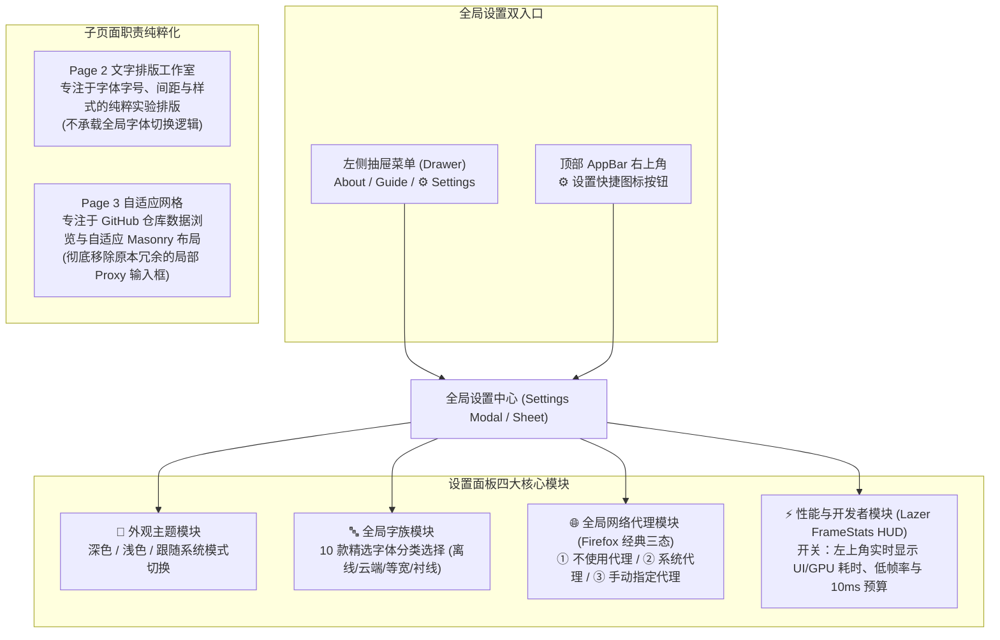
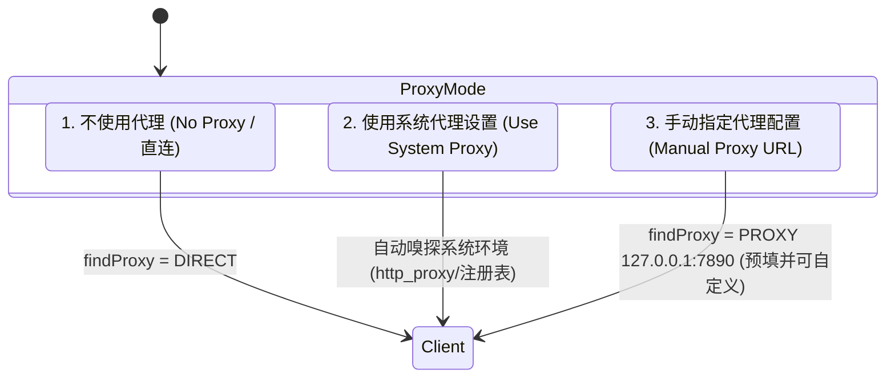
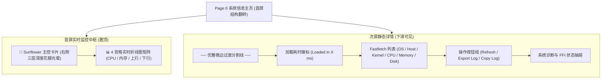
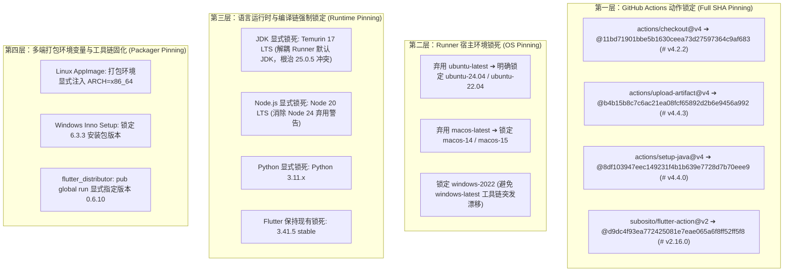
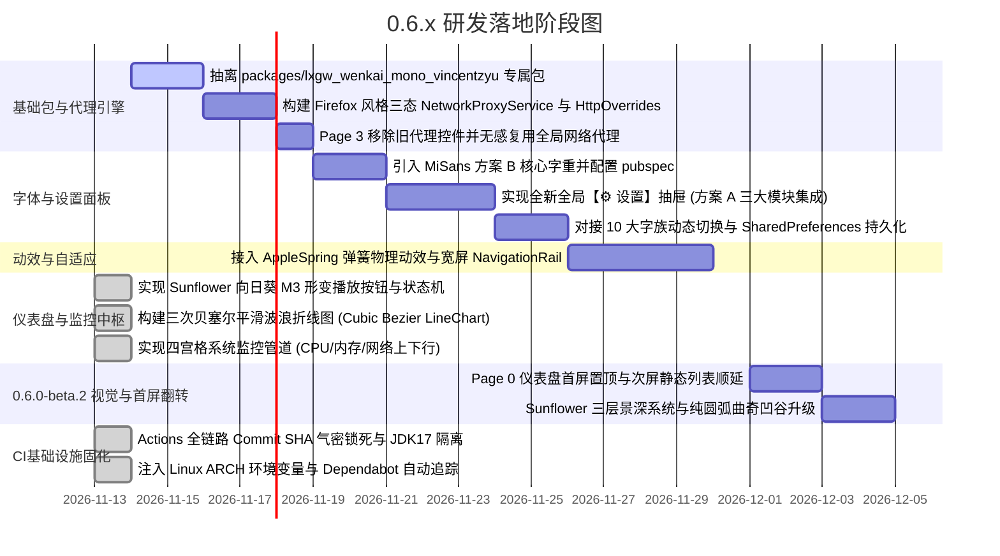

# 20261113.新版本 0.6.x 的字体、代理与界面 UI 综合优化规划

## 1. 概述与演进背景

随着 `0.5.6` 正式版发布并确立了桌面平台集成的稳定基线，`0.6.x` 阶段正式开启。
本阶段将致力于**视觉美学重塑、全局配置高内聚收拢与跨平台体验提升**：
1. **单一职责与全局设置（方案 A）**：设立统一的【⚙️ 设置】抽屉/面板，彻底收拢“主题模式”、“全局 10 大字族”与“Firefox 经典三态代理配置”，剥离各子页面的冗余局部配置；
2. **全局多字体工程架构**：构建独立的等宽字体包 `packages/lxgw_wenkai_mono_vincentzyu`，融合 MiSans 本地 Asset 与 Google Fonts 在线流式字族，提供 10 款精选字体；
3. **Firefox 式全局代理三态系统**：收拢原 Page 3 中的分散代理逻辑，建立支持“直连 / 系统代理 / 手动代理”的全局 `HttpOverrides` 管道，既为 GitHub API 护航，也彻底解决国内环境下 Google Fonts 首次拉取的网络阻断问题；
4. **Lazer 与 FlClash 体验精髓**：引入 WWDC23 AppleSpring 弹簧物理动效、自适应宽屏 NavigationRail 与扁平化分组卡片。

---

## 2. 交互入口重塑：纯粹的方案 A（全新全局设置中心）

确立为**方案 A（全新全局设置中心）**，彻底收纳全局配置，并实现页面职责的纯粹化解耦：



### 2.1 全局设置入口定位（解惑：当前版本为什么找不到设置？）
- **当前现状（0.6.0-beta.1）**：目前版本尚未挂载统一的全局设置页面，配置依然是分散的（右上角月亮仅切主题、Page 3 仅切代理输入、Page 2 仅为排版实验室，左侧抽屉仅有 About/Guide）；
- **新版落地规划**：
  1. **左侧抽屉 Drawer 新增一级入口**：在 `About` 与 `Guide` 紧接着增加 `⚙️ Settings (应用设置)`；
  2. **顶部 AppBar 快捷图标**：在右上角深色模式切换图标旁增加 `⚙️` 图标，点击直接呼出全新设置面板。

### 2.2 Lazer 灵感：左上角实时性能胶囊（FrameStats HUD）
参考 Lazer 左上角的实时性能指示器，在设置面板中提供可配置的开关：
- **胶囊视觉呈现**：
  ```
  ┌────────────────────────────────────────────────────────────────────────┐
  │ 🔴 58 fps  低帧 42  UI 0.8 ms  GPU 3.2 ms  预算 10 ms  峰值 9.1 ms      │
  └────────────────────────────────────────────────────────────────────────┘
  ```
- **核心采集技术（Flutter Engine 原生无开销采样）**：
  - 注册 `SchedulerBinding.instance.addTimingsCallback` 监听真实渲染周期；
  - 统计最近 150 帧的滑动窗口（Rolling Window）：
    - `fps`：真实呈现帧率；
    - `lowFps`：第 5 百分位低帧率（精准暴露微卡顿，比平均帧率更能反映掉帧）；
    - `UI (buildMs)`：`ui.FramePhase.buildFinish - ui.FramePhase.buildStart` 耗时；
    - `GPU (rasterMs)`：`ui.FramePhase.rasterFinish - ui.FramePhase.rasterStart` 光栅化耗时；
    - `预算 (budget)`：10ms 帧预算与最长帧 `worstMs`；
- **配置与持久化**：
  - 在设置面板中提供 Switch 开关：`【实时显示 UI、GPU、低帧和 100 fps 帧预算】`；
  - 开关状态持久化至 `SharedPreferences`。

### 2.3 页面瘦身与净化要点：
- **Page 2（文字排版工作室）**：回归“纯粹排版实验场”的初心，提供字号、字距、行高、色板与文字对比调试，不再喧宾夺主承载全局字体切换；
- **Page 3（自适应网格）**：**彻底移除**内部原有的 `_proxyController`（`http://127.0.0.1:7890`）与 `_useProxy` 勾选框，页面布局大幅清爽，数据拉取统一静默复用全局网络代理配置。

---

## 3. Firefox 式三态全局代理系统设计

借鉴 **Mozilla Firefox 经典网络连接设置（Network Connection Settings）**，设计直观、专业的单选三态代理控制模型：



### 3.1 三大单选状态定义（ProxyMode 枚举）

| 模式 | 单选标签 | 行为定义与底层机制 | 适用场景 |
|---|---|---|---|
| **`direct`** | **不使用代理 (直连)** | `client.findProxy = (_) => 'DIRECT';`<br/>强制直连，忽略所有系统或环境变量代理 | 海外网络或网络完全畅通环境 |
| **`system`** | **使用系统代理设置** | 自动嗅探操作系统环境代理（WinINet 注册表 / macOS scutil / Linux `http_proxy` 环境变量） | 默认接入宿主系统 VPN 或全局透明代理 |
| **`manual`** | **手动配置代理** | 单选激活下方 URL 输入框，默认预填 **`http://127.0.0.1:7890`**，支持 HTTP/SOCKS 格式校验 | Clash、Mihomo、v2rayN、FlClash 等本地监听客户端 |

### 3.2 架构实现（全局 HttpOverrides）
构建单例服务 `NetworkProxyService`，在应用启动及用户切换单选项时动态生效：
```dart
enum ProxyMode { direct, system, manual }

class NetworkProxySettings {
  final ProxyMode mode;
  final String manualUrl; // 默认 'http://127.0.0.1:7890'

  const NetworkProxySettings({
    this.mode = ProxyMode.direct,
    this.manualUrl = 'http://127.0.0.1:7890',
  });
}
```

---

## 4. 全局 10 款多元字族矩阵设计

将全平台字族精选分为 5 大实用维度，共 10 款方案：

| 分组类别 | 序号 | 字体选项 ID | 选项显示标签 | 底层技术载体 | 核心亮点与对比场景 |
|---|:---:|---|---|---|---|
| **内置完全离线族**<br>*(3款)* | 1 | `miSans` | **小米 MiSans** (内置) | 本地 Asset (`MiSans-*.ttf`) | 现代中性质感、全平台超清晰屏显，采纳方案 B 核心字重 |
| | 2 | `lxgwMonoLocal` | **霞鹜文楷等宽** (本地包) | `packages/lxgw_wenkai_mono...` | 专属等宽 package、100% 离线、0 延迟秒开、国风手写兼备 |
| | 3 | `system` | **系统原生默认** | 宿主 OS 默认 Typography | 零体积开销，完全融入 Windows / macOS / Linux 宿主 |
| **云端双模对比**<br>*(1款)* | 4 | `lxgwGoogle` | **霞鹜文楷** (Google 云端) | `GoogleFonts.lxgwWenKaiTc()` | 展示动态网络字体流式下载、缓存与本地对比 |
| **国际经典无衬线**<br>*(3款)* | 5 | `inter` | **Inter** (Google Fonts) | `GoogleFonts.inter()` | 国际公认最舒适的现代 UI 西文字体，类似 Apple SF Pro |
| | 6 | `roboto` | **Roboto** (Google Fonts) | `GoogleFonts.roboto()` | Android 与 Material Design 标杆字体 |
| | 7 | `poppins` | **Poppins** (Google Fonts) | `GoogleFonts.poppins()` | 饱满圆润的几何感，现代前卫视觉排版必备 |
| **极客代码编程区**<br>*(2款)* | 8 | `jetBrainsMono`| **JetBrains Mono** (代码) | `GoogleFonts.jetBrainsMono()` | 码农 IDE 挚爱，扩大的小写字母与专有连字设计 |
| | 9 | `firaCode` | **Fira Code** (代码) | `GoogleFonts.firaCode()` | 编程连字等宽鼻祖，清爽极客风 |
| **东方传统美学**<br>*(1款)* | 10 | `notoSerifSc` | **思源宋体** (Google Fonts) | `GoogleFonts.notoSerifSc()` | 传统衬线阅读质感，古雅端庄的长文本排版 |

---

## 5. 独立 Package：`packages/lxgw_wenkai_mono_vincentzyu`

- **纯粹等宽定位**：专职打包 **LXGW WenKai Mono**，不混杂比例字体，保持纯净；
- **完全开源协议**：**SIL Open Font License 1.1**，商业免费、无任何分发限制；
- **外部项目复用**：
  - 本地项目通过 `path: ../dart-flutter-demo/packages/lxgw_wenkai_mono_vincentzyu` 直接引用；
  - 外部项目通过 `git: { url: https://github.com/VincentZyuApps/dart-flutter-demo.git, path: packages/lxgw_wenkai_mono_vincentzyu }` 无缝接入。

---

## 6. 0.6.0-beta.2 进阶：首屏仪表盘置顶与三层 Sunflower 曲奇光晕系统

在 `0.6.0-beta.1` 完成初版原型验证后，根据 FlClash 真实视觉体验，在 `0.6.0-beta.2` 展开深度美学与信息架构升级：



### 6.1 Page 0 信息架构重塑：Dashboard-First 仪表盘首屏置顶
- **主次颠倒**：将用户一打开 App 最想看到、最具体验冲击力的**“实时系统监视器（Sunflower 主卡 + 四宫格）”整体置顶为首屏**；
- **沉浸下滑**：原本相对静态的 fastfetch 风格硬件参数（主机名、内核版本、磁盘详情、语言区域等）整体顺延至下方，用户随手下滑即可查阅；
- **视觉平衡**：从“静态文本列表”变为“动态科技感仪表盘”，彻底重塑主页的现代技术质感。

### 6.2 Sunflower（太阳花 / 曲奇向日葵）三层景深光晕体系
对照 FlClash 超清特写（`uploaded_media_0` 与 `uploaded_media_2`），解决初版向日葵层次偏单薄、波谷稍显星形尖角的问题，构建三层深度光学系统：

```
┌────────────────────────────────────────────────────────────────┐
│  主控卡片右侧 Sunflower 核心三层光学结构                        │
│                                                                │
│  [第 1 层：底层] 不规则暗色水滴/波浪云层遮罩 (Fluid Backdrop)    │
│       └── 占据卡片右侧 40% 面积，呈现类似深蓝墨滴的不规则流动曲面  │
│                                                                │
│  [第 2 层：中层] 淡淡的浅色向日葵光环 (Ghost Sunflower Bloom)   │
│       └── 比主体大 1.22x，半透明浅蓝色 (Primary 0.28 Alpha)，   │
│           相位微错位 15°，营造多重花瓣层叠盛开与柔和背光漫反射     │
│                                                                │
│  [第 3 层：顶层] 鲜艳高亮曲奇向日葵 (Core Sunflower Cookie-12)  │
│       └── 优化三次贝塞尔切线算法，波谷全圆弧化，彻底消除尖锐折角，│
│           圆润饱满的 Cookie-12 曲奇花瓣，中央白色动态形变图标     │
└────────────────────────────────────────────────────────────────┘
```

1. **第 1 层（底层 - 不规则墨色流体水滴 Fluid Backdrop）**：
   - 绘制右侧局部流体不规则曲面，以深灰蓝半透明融入卡片暗色基底，作为整个按键区的承载底座；
2. **第 2 层（中层 - 浅色半透明幽灵花环 Ghost Bloom）**：
   - 紧贴蓝色 Sunflower 正后方，叠加一个略大（1.20~1.25x）的浅色花瓣层，随旋转产生多层向日葵叶片错位视觉，带发光呼吸感；
3. **第 3 层（顶层 - 纯圆润 Cookie-12 曲奇花瓣）**：
   - 改写插值方程，让 12 个花瓣凹谷全部以相切圆弧（Tangential Bezier Arcs）过渡，触感极度圆润饱满，消除生硬的星形棱角；
   - 保持 0~1 的正圆（Circle）到 12 瓣向日葵平滑形变，逆时针 2π/12 旋转与 1.10x 动量回弹。

### 6.3 实时三次贝塞尔平滑波浪折线图（Smooth Wave Line Chart）
- **采样点平滑插值**：采用三次贝塞尔曲线连接，杜绝直线锯齿折角；
- **流体垂直渐变**：前景色 2.0px 高亮 Stroke，底部向下填充透明度渐变（0.22 -> 0.0）；
- **独立渲染边界**：图表采用 `RepaintBoundary` 进行隔离，确保 1.0s 采样高频刷新不引起全局 Widget 树 dirty 重构。

---

## 7. UI 与全局动效升级（融合 Lazer & FlClash）

1. **WWDC23 AppleSpring 弹簧物理动效**：
   - 替换原有的线性 PageTransitionsTheme，采用感知响应 Duration = 350ms、阻尼 Bounce = 0.12 的温润物理曲线；
2. **自适应宽屏脚手架（NavigationRail）**：
   - 窗口宽度 >= 800dp 时底部导航栏平滑转换为侧边栏；
3. **FlClash 风格分组卡片重构**：
   - 全局设置面板与子页面卡片统一采用 10% 细边框描边与微妙 Elevation，带来呼吸感与秩序感。

---

---

## 8. CI/CD 基础设施固化规划（四层防御与 Commit SHA 气密锁死）

针对 0.5.6 与 0.6.0-beta.1 跨平台构建中暴露的云端宿主漂移（Linux `appimagetool` 缺少 `ARCH` 报错、GitHub Runner 默认 JDK 升级至 Java 25 导致 Gradle 冲突），规划遵循 **OpenSSF 与 Google SLSA 供应链安全标准** 的全链路气密固化：



### 8.1 固化落地细则
1. **GitHub Actions 40 位 SHA 锁定**：
   - 彻底废除浮动 Tag（如 `@v4`），防止上游意外破坏或恶意劫持覆盖，每个 Action 显式附带 `# vX.X.X` 语义化注释；
2. **宿主隔离与 Java 17 LTS 强制介入**：
   - 在 Android Release 构建与 Profile 构建中，强制先执行 `setup-java: 17`，阻断 GitHub Runner 自带 Java 25 的干扰；
3. **Linux 打包环境变量锁死**：
   - 在 Linux 构建步骤的 `env:` 中明确注入 `ARCH: x86_64`，根除 `appimagetool` 的架构校验拦截；
4. **自动化升级维护（Dependabot 协同）**：
   - 配置 `.github/dependabot.yml` 对 `github-actions` 生态按月扫描，自动化提 PR 更新 Commit Hash，保证可控演进。

---

## 9. 演进路线图与实施阶段


