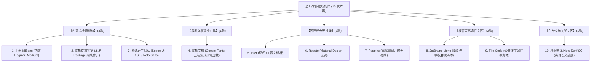
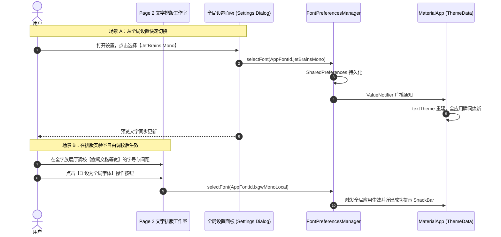

# 20261113.新版本 0.6.x 的字体和界面 UI 等等优化规划

## 1. 概述与演进背景

在 `0.5.6` 正式版圆满完成全平台桌面集成（Windows 缩略图工具栏/跳转列表、Linux MPRIS 媒体控件及多桌面通知）后，应用正式确立了 LTS 底层能力基线。
迈入 **`0.6.x` 阶段**，项目重心将聚焦于：
1. **构建工程级的“全局多字体系统”**（支持独立 Package 复用、本地离线与云端流式双模、多达 10 款多元字族阵容）；
2. **汲取 Lazer 与 FlClash 的高阶设计美学**（WWDC23 弹簧物理动效、自适应桌面侧边栏与分组卡片式设计）。

---

## 2. 标杆项目设计精髓沉淀

### 2.1 Lazer（物理动效与字族工程化）
- **WWDC23 AppleSpring 弹簧物理引擎**：基于感知响应时长（Duration）与弹性阻尼（Bounce），赋予页面跳转与模态窗口无与伦比的温润阻尼手感。
- **合成器无闪烁视图切换（RetainedContentSwitcher）**：维持跨路由 RenderObject 连续性，拒绝页面切换闪烁。
- **MiSans 字体工程化**：采用 **方案 B** 轻量化策略，仅抽取 **Regular (400) + Medium/Semibold (600)** 两个最核心字重（约 16MB），以私有 Asset 形式内置于主应用中。

### 2.2 FlClash（自适应布局与设计令牌）
- **响应式桌面/移动双模脚手架**：宽屏下自动展开为侧边栏 NavigationRail，窄屏折叠为底部导航栏。
- **扁平分组卡片（Grouped-Card Layout）**：统一圆角、细边缘描边（10% 不透明度）与微阴影，视觉秩序极高。

---

## 3. 字体工程体系架构：独立 Package 与本地/云端双模

### 3.1 独立通用字体包 `packages/lxgw_wenkai_mono_vincentzyu`
为实现跨项目复用与开源资产沉淀，将霞鹜文楷等宽抽离为独立子包：
- **专职定位**：专注承载 **等宽单字重（LXGW WenKai Mono）**，纯粹专精。
- **开源合规**：基于 **SIL Open Font License 1.1**，商用完全免费、分发无限制。
- **跨项目复用支持**：
  ```yaml
  # 方式 1：本地同构项目 Path 依赖
  dependencies:
    lxgw_wenkai_mono_vincentzyu:
      path: ../dart-flutter-demo/packages/lxgw_wenkai_mono_vincentzyu

  # 方式 2：任意外部项目 Git 仓库依赖
  dependencies:
    lxgw_wenkai_mono_vincentzyu:
      git:
        url: https://github.com/VincentZyuApps/dart-flutter-demo.git
        path: packages/lxgw_wenkai_mono_vincentzyu
        ref: main
  ```

### 3.2 资产与权限切分原则
- **`lxgw_wenkai_mono_vincentzyu`**：独立公共 package，遵循 SIL OFL 1.1。
- **`MiSans`**：遵循小米知识产权协议，作为主应用私有 Asset 内嵌（避免公共包分发限制）。

---

## 4. 全局 10 款多元字体选项矩阵

将字体库细分为 5 大实用维度，共提供 **10 款精选字族**：



| 序号 | 字体选项 ID | 选项显示标签 | 底层技术载体 | 核心亮点与对比场景 |
|:---:|---|---|---|---|
| 1 | `miSans` | **小米 MiSans** (内置) | 本地 Asset (`MiSans-*.ttf`) | 现代中性质感、全平台极高清晰度屏显 |
| 2 | `lxgwMonoLocal` | **霞鹜文楷等宽** (本地包) | `packages/lxgw_wenkai_mono...` | 100% 离线、0 延迟秒开、国风等宽兼备 |
| 3 | `system` | **系统原生默认** | 宿主 OS 默认 Typography | 零包体积负担，与各操作系统浑然一体 |
| 4 | `lxgwGoogle` | **霞鹜文楷** (Google 云端) | `GoogleFonts.lxgwWenKaiTc()` | 展示动态网络流式下载、缓存与本地对比 |
| 5 | `inter` | **Inter** (Google Fonts) | `GoogleFonts.inter()` | 国际公认最舒适的数字界面无衬线西文字体 |
| 6 | `roboto` | **Roboto** (Google Fonts) | `GoogleFonts.roboto()` | Android 经典无衬线，几何工整 |
| 7 | `poppins` | **Poppins** (Google Fonts) | `GoogleFonts.poppins()` | 饱满圆润的几何感，常用于现代前卫排版 |
| 8 | `jetBrainsMono`| **JetBrains Mono** (代码) | `GoogleFonts.jetBrainsMono()` | 码农 IDE 挚爱，扩大的小写字母与符号连字 |
| 9 | `firaCode` | **Fira Code** (代码) | `GoogleFonts.firaCode()` | 编程连字等宽鼻祖，清爽极客风 |
| 10 | `notoSerifSc` | **思源宋体** (Google Fonts) | `GoogleFonts.notoSerifSc()` | 传统衬线阅读质感，古雅端庄的长文本排版 |

---

## 5. 交互方案 C 落地：全局设置 + Page 2 双向联动



1. **全局设置面板**：
   - 提供 5 大分类的分组卡片列表；
   - 每一行展示字体名称、技术标签（`离线` / `云端` / `等宽`）与实时渲染样本（`排版示例文本 123 ABC`）；
   - 点击即刻无缝切换。
2. **Page 2 深度赋能**：
   - 升级为“全字族展厅”，不仅能对比这 10 款字族的字形细节，还能一键将心仪的调校结果设为全应用全局字体。

---

## 6. UI 与动效升级清单

1. **AppleSpring 物理弹性动效**：
   - 将 `PageTransitionsTheme` 改造为支持物理阻尼的弹性曲线（Duration = 350ms, Bounce = 0.12），告别生硬滑动。
2. **自适应宽屏脚手架（NavigationRail）**：
   - 视口宽度 >= 800dp 时，底部导航无感折叠并平滑移至左侧。
3. **FlClash 式分组卡片重构**：
   - 优化 Page 0 系统信息、Page 1 对话框实验室与 Page 4 控件反馈页，卡片加入轻量描边与层级 Elevation。

---

## 7. 阶段实施计划

- **阶段 1：基础架构沉淀**
  - 创建 `packages/lxgw_wenkai_mono_vincentzyu` 专属子包并接入主工程。
  - 从 Lazer 引入 `MiSans-Regular.ttf` 与 `MiSans-Medium.ttf` 到本地 Assets。
- **阶段 2：字族引擎与状态持久化**
  - 封装 `FontPreferencesService`，对接 10 款字族与本地缓存。
- **阶段 3：交互与动效赋能**
  - 重构全局设置弹窗（方案 C）与 Page 2 一键应用按钮。
  - 引入 AppleSpring 弹簧动效与自适应 NavigationRail。
