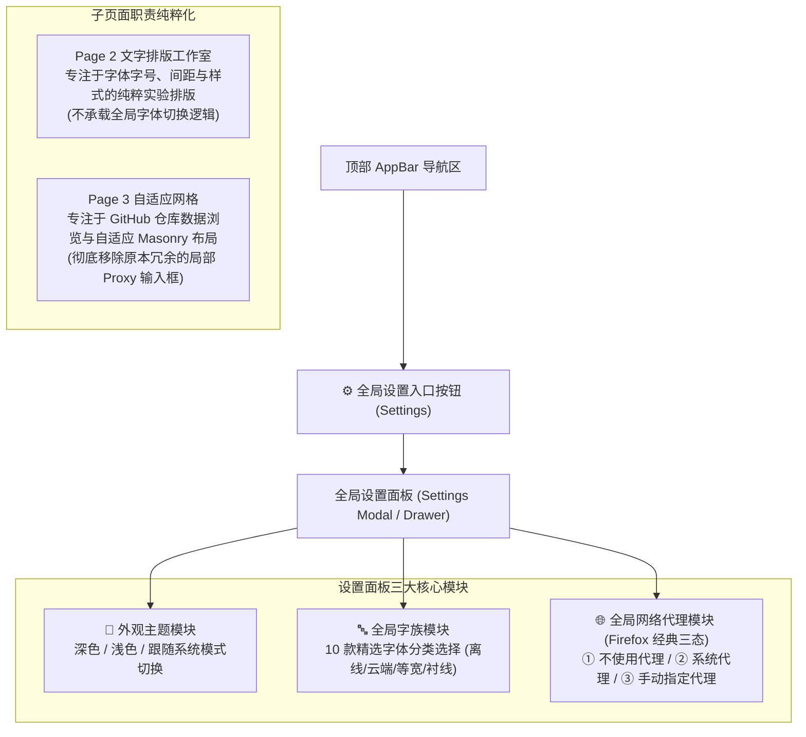
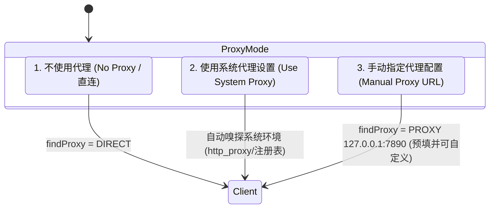
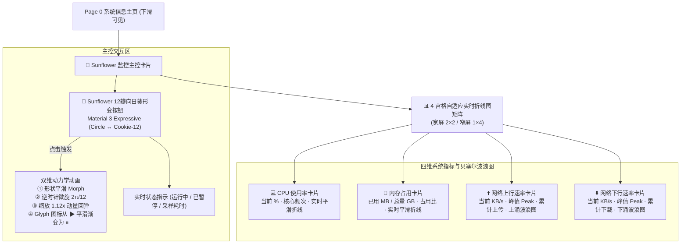
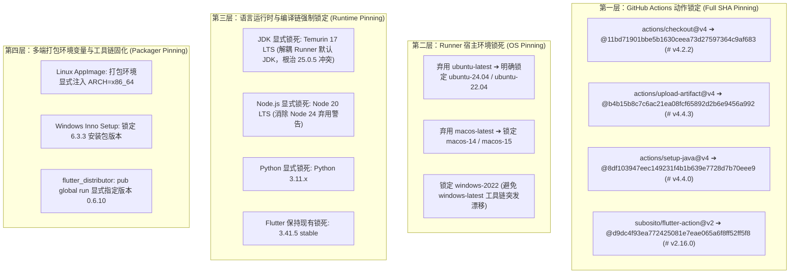
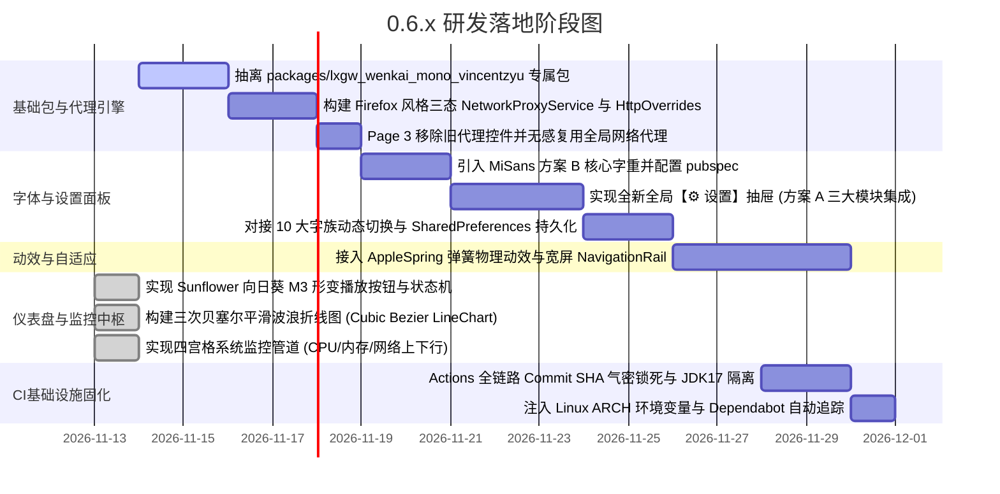

# 20261113.新版本 0.6.x 的字体、代理与界面 UI 综合优化规划

## 1. 概述与演进背景

随着 `0.5.6` 正式版发布并确立了桌面平台集成的稳定基线，`0.6.x` 阶段正式开启。
本阶段将致力于**视觉美学重塑、全局配置高内聚收拢与跨平台体验提升**：
1. **单一职责与全局设置（方案 A）**：设立统一的【⚙️ 设置】抽屉/面板，彻底收拢“主题模式”、“全局 10 大字族”与“Firefox 经典三态代理配置”，剥离各子页面的冗余局部配置；
2. **全局多字体工程架构**：构建独立的等宽字体包 `packages/lxgw_wenkai_mono_vincentzyu`，融合 MiSans 本地 Asset 与 Google Fonts 在线流式字族，提供 10 款精选字体；
3. **Firefox 式全局代理三态系统**：收拢原 Page 3 中的分散代理逻辑，建立支持“直连 / 系统代理 / 手动代理”的全局 `HttpOverrides` 管道，既为 GitHub API 护航，也彻底解决国内环境下 Google Fonts 首次拉取的网络阻断问题；
4. **Lazer 与 FlClash 体验精髓**：引入 WWDC23 AppleSpring 弹簧物理动效、自适应宽屏 NavigationRail 与扁平化分组卡片。

---

## 2. 交互入口重塑：纯粹的方案 A（全新全局设置中心）

确立为**方案 A（单一全局入口）**，实现页面职责的纯粹化解耦：



### 页面瘦身与净化要点：
- **Page 2（文字排版工作室）**：回归“纯粹排版实验场”的初心，提供字号、字距、行高、色板与文字对比调试，不再喧宾夺主承载全局字体切换；
- **Page 3（自适应网格）**：**彻底移除**内部原有的 `_proxyController`（`http://127.0.0.1:7890`）与 `_useProxy` 勾选框，页面布局大幅清爽，数据拉取统一静默复用全局网络代理配置。

---

## 3. Firefox 式三态全局代理系统设计

借鉴 **Mozilla Firefox 经典网络连接设置（Network Connection Settings）**，设计直观、专业的单选三态代理控制模型：



### 3.1 三大单选状态定义（ProxyMode 枚举）

| 模式 | 单选标签 | 行为定义与底层机制 | 适用场景 |
|---|---|---|---|
| **`direct`** | **不使用代理 (直连)** | `client.findProxy = (_) => 'DIRECT';`<br/>强制直连，忽略所有系统或环境变量代理 | 海外网络或网络完全畅通环境 |
| **`system`** | **使用系统代理设置** | 自动嗅探操作系统环境代理（WinINet 注册表 / macOS scutil / Linux `http_proxy` 环境变量） | 默认接入宿主系统 VPN 或全局透明代理 |
| **`manual`** | **手动配置代理** | 单选激活下方 URL 输入框，默认预填 **`http://127.0.0.1:7890`**，支持 HTTP/SOCKS 格式校验 | Clash、Mihomo、v2rayN、FlClash 等本地监听客户端 |

### 3.2 架构实现（全局 HttpOverrides）
构建单例服务 `NetworkProxyService`，在应用启动及用户切换单选项时动态生效：
```dart
enum ProxyMode { direct, system, manual }

class NetworkProxySettings {
  final ProxyMode mode;
  final String manualUrl; // 默认 'http://127.0.0.1:7890'

  const NetworkProxySettings({
    this.mode = ProxyMode.direct,
    this.manualUrl = 'http://127.0.0.1:7890',
  });
}
```

---

## 4. 全局 10 款多元字族矩阵设计

将全平台字族精选分为 5 大实用维度，共 10 款方案：

| 分组类别 | 序号 | 字体选项 ID | 选项显示标签 | 底层技术载体 | 核心亮点与对比场景 |
|---|:---:|---|---|---|---|
| **内置完全离线族**<br>*(3款)* | 1 | `miSans` | **小米 MiSans** (内置) | 本地 Asset (`MiSans-*.ttf`) | 现代中性质感、全平台超清晰屏显，采纳方案 B 核心字重 |
| | 2 | `lxgwMonoLocal` | **霞鹜文楷等宽** (本地包) | `packages/lxgw_wenkai_mono...` | 专属等宽 package、100% 离线、0 延迟秒开、国风手写兼备 |
| | 3 | `system` | **系统原生默认** | 宿主 OS 默认 Typography | 零体积开销，完全融入 Windows / macOS / Linux 宿主 |
| **云端双模对比**<br>*(1款)* | 4 | `lxgwGoogle` | **霞鹜文楷** (Google 云端) | `GoogleFonts.lxgwWenKaiTc()` | 展示动态网络字体流式下载、缓存与本地对比 |
| **国际经典无衬线**<br>*(3款)* | 5 | `inter` | **Inter** (Google Fonts) | `GoogleFonts.inter()` | 国际公认最舒适的现代 UI 西文字体，类似 Apple SF Pro |
| | 6 | `roboto` | **Roboto** (Google Fonts) | `GoogleFonts.roboto()` | Android 与 Material Design 标杆字体 |
| | 7 | `poppins` | **Poppins** (Google Fonts) | `GoogleFonts.poppins()` | 饱满圆润的几何感，现代前卫视觉排版必备 |
| **极客代码编程区**<br>*(2款)* | 8 | `jetBrainsMono`| **JetBrains Mono** (代码) | `GoogleFonts.jetBrainsMono()` | 码农 IDE 挚爱，扩大的小写字母与专有连字设计 |
| | 9 | `firaCode` | **Fira Code** (代码) | `GoogleFonts.firaCode()` | 编程连字等宽鼻祖，清爽极客风 |
| **东方传统美学**<br>*(1款)* | 10 | `notoSerifSc` | **思源宋体** (Google Fonts) | `GoogleFonts.notoSerifSc()` | 传统衬线阅读质感，古雅端庄的长文本排版 |

---

## 5. 独立 Package：`packages/lxgw_wenkai_mono_vincentzyu`

- **纯粹等宽定位**：专职打包 **LXGW WenKai Mono**，不混杂比例字体，保持纯净；
- **完全开源协议**：**SIL Open Font License 1.1**，商业免费、无任何分发限制；
- **外部项目复用**：
  - 本地项目通过 `path: ../dart-flutter-demo/packages/lxgw_wenkai_mono_vincentzyu` 直接引用；
  - 外部项目通过 `git: { url: https://github.com/VincentZyuApps/dart-flutter-demo.git, path: packages/lxgw_wenkai_mono_vincentzyu }` 无缝接入。

---

## 6. FlClash 灵感：Sunflower 动态监控中枢与四宫格贝塞尔波浪曲线

在 Page 0（系统信息主页）中引入源自 FlClash 仪表盘美学的**核心实时监控矩阵**，作为 demo 项目的技术探索与高质量视觉样板：



### 6.1 Sunflower（向日葵 / 曲奇饼）形变按钮架构
- **几何与形变数学（Material 3 Expressive Morph）**：
  - 采用 M3 Expressive 的多边曲率多边形 `MaterialShapes.cookie12Sided`（12 瓣波浪花瓣凹凸轮廓）；
  - 待机（Stopped）：平滑回缩至圆形或微圆角多边形，中央呈现实心播放图标 `Play`；
  - 激活（Running）：通过 `TweenAnimationBuilder` 驱动 `Morph(circle, cookie12Sided)`，伴随轻微旋转 `Transform.rotate(angle: 2 * pi / 12 * progress)` 与微动放大 `Transform.scale(scale: 1 + 0.12 * progress)`，图标以矢量形变平滑转为 `Pause`；
  - **背景呼吸层**：按钮背后垫一层半透明、大尺寸的同构深色波浪阴影徽标（`ShapeBadge`），产生自然的水波流动层次感。

### 6.2 实时三次贝塞尔平滑波浪折线图（Smooth Wave Line Chart）
- **平滑插值算法**：
  - 不采用折线直线连接（避免尖锐锯齿），采样点间采用三次贝塞尔曲线（Cubic Bezier）插值；
  - 控制点基于前后采样点的切线与距离动态解算，平滑贴合波浪起伏；
- **流体渐变与卡片溢出（Bleed & Gradient）**：
  - 顶部描边：2.0px 高亮前景色（上行绿色/下行主蓝色/CPU 紫色/内存青色）；
  - 底部填充：向下闭合到底部边缘，填充由主色（Alpha 0.25）到完全透明（Alpha 0.0）的垂直线性渐变（`LinearGradient`）；
- **渲染隔离与性能护栏**：
  - 采用容量为 30~60 个周期的定长环形队列（`FixedList<double>`）；
  - 监控采样间隔建议为 1.0 秒；
  - 图表采用独立的 `CustomPainter` 并使用 `RepaintBoundary` 严格隔离重绘作用域，确保折线图高频刷新不拖累外层页面树。

### 6.3 响应式网格布局（Responsive 4-Grid）
- **宽屏桌面（>= 800dp）**：采用 2x2 经典四宫格并排，与上方 Sunflower 主控卡片呼应；
- **紧凑窄屏（< 800dp）**：自适应切换为 1 列 4 行的流式紧凑卡片，保障移动端信息密度的易读性；
- **位置归宿**：集成在 Page 0（系统信息主页），向下滑动即可呈现，与静态硬件参数相得益彰。

---

## 7. UI 与全局动效升级（融合 Lazer & FlClash）

1. **WWDC23 AppleSpring 弹簧物理动效**：
   - 替换原有的线性 PageTransitionsTheme，采用感知响应 Duration = 350ms、阻尼 Bounce = 0.12 的温润物理曲线；
2. **自适应宽屏脚手架（NavigationRail）**：
   - 窗口宽度 >= 800dp 时底部导航栏平滑转换为侧边栏；
3. **FlClash 风格分组卡片重构**：
   - 全局设置面板与子页面卡片统一采用 10% 细边框描边与微妙 Elevation，带来呼吸感与秩序感。

---

---

## 8. CI/CD 基础设施固化规划（四层防御与 Commit SHA 气密锁死）

针对 0.5.6 与 0.6.0-beta.1 跨平台构建中暴露的云端宿主漂移（Linux `appimagetool` 缺少 `ARCH` 报错、GitHub Runner 默认 JDK 升级至 Java 25 导致 Gradle 冲突），规划遵循 **OpenSSF 与 Google SLSA 供应链安全标准** 的全链路气密固化：



### 8.1 固化落地细则
1. **GitHub Actions 40 位 SHA 锁定**：
   - 彻底废除浮动 Tag（如 `@v4`），防止上游意外破坏或恶意劫持覆盖，每个 Action 显式附带 `# vX.X.X` 语义化注释；
2. **宿主隔离与 Java 17 LTS 强制介入**：
   - 在 Android Release 构建与 Profile 构建中，强制先执行 `setup-java: 17`，阻断 GitHub Runner 自带 Java 25 的干扰；
3. **Linux 打包环境变量锁死**：
   - 在 Linux 构建步骤的 `env:` 中明确注入 `ARCH: x86_64`，根除 `appimagetool` 的架构校验拦截；
4. **自动化升级维护（Dependabot 协同）**：
   - 配置 `.github/dependabot.yml` 对 `github-actions` 生态按月扫描，自动化提 PR 更新 Commit Hash，保证可控演进。

---

## 9. 演进路线图与实施阶段


