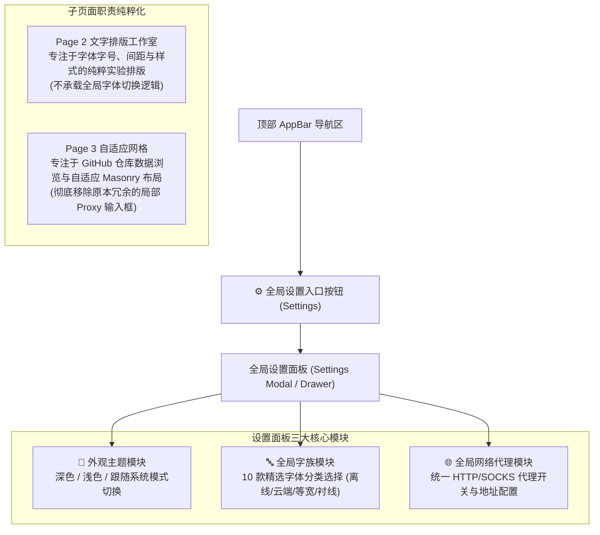
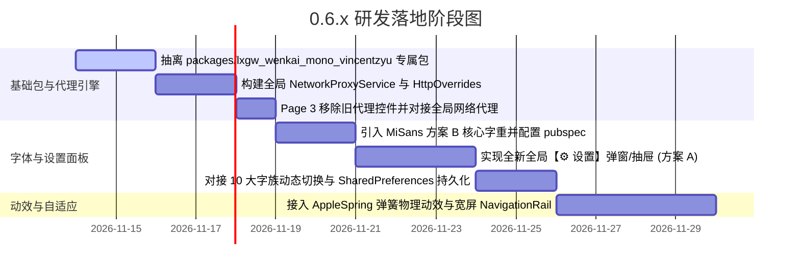

# 20261113.新版本 0.6.x 的字体、代理与界面 UI 综合优化规划

## 1. 概述与演进背景

随着 `0.5.6` 正式版发布并确立了桌面平台集成的稳定基线，`0.6.x` 阶段正式开启。
本阶段将致力于**视觉美学重塑、全局配置高内聚收拢与跨平台体验提升**：
1. **单一职责与全局设置（方案 A）**：设立统一的【⚙️ 设置】抽屉/面板，彻底收拢“主题模式”、“全局 10 大字族”与“全局网络代理”，剥离各子页面的冗余局部配置；
2. **全局多字体工程架构**：构建独立的等宽字体包 `packages/lxgw_wenkai_mono_vincentzyu`，融合 MiSans 本地 Asset 与 Google Fonts 在线流式字族，提供 10 款精选字体；
3. **全局代理体系**：收拢原 Page 3 中的分散代理逻辑，建立全局 `HttpOverrides` 代理管道，既为 GitHub API 护航，也彻底解决国内环境下 Google Fonts 首次拉取的网络阻断问题；
4. **Lazer 与 FlClash 体验精髓**：引入 WWDC23 AppleSpring 弹簧物理动效、自适应宽屏 NavigationRail 与扁平化分组卡片。

---

## 2. 交互入口重塑：纯粹的方案 A（全新全局设置中心）

此前探讨过三种交互承载方案，最终决策确立为**方案 A（单一全局入口）**，实现页面职责的纯粹化解耦：



### 页面瘦身与净化要点：
- **Page 2（文字排版工作室）**：回归“纯粹排版实验场”的初心，提供字号、字距、行高、色板与文字对比调试，不再喧宾夺主承载全局字体切换；
- **Page 3（自适应网格）**：**彻底移除**内部原有的 `_proxyController`（`http://127.0.0.1:7890`）与 `_useProxy` 勾选框，页面布局大幅清爽，数据拉取统一静默复用全局网络代理配置。

---

## 3. 全局代理系统（Network & Proxy Architecture）

### 3.1 设立全局代理的必要性
- **保障 Google Fonts 云端字族拉取**：国内网络直连 Google Fonts CDN（`fonts.gstatic.com`）偶有超时或阻断。全局代理一旦开启，Flutter 在线字体下载将丝滑秒下；
- **保障 GitHub API 与元数据访问**：GitHub 个人/组织仓库拉取不再受特定页面限制；
- **多平台通用支持**：适配 Windows、macOS、Linux、Android、iOS。

### 3.2 架构实现（全局 HttpOverrides）
构建单例服务 `NetworkProxyService`，在应用初始化及用户切换代理时动态应用：
```dart
class AppHttpOverrides extends HttpOverrides {
  final String? proxyUrl;
  AppHttpOverrides(this.proxyUrl);

  @override
  HttpClient createHttpClient(SecurityContext? context) {
    final client = super.createHttpClient(context);
    if (proxyUrl != null && proxyUrl!.isNotEmpty) {
      final uri = Uri.tryParse(proxyUrl!);
      if (uri != null && uri.host.isNotEmpty && uri.port > 0) {
        client.findProxy = (_) => 'PROXY ${uri.host}:${uri.port}';
      }
    }
    return client;
  }
}
```

---

## 4. 全局 10 款多元字族矩阵设计

将全平台字族精选分为 5 大实用维度，共 10 款方案：

| 分组类别 | 序号 | 字体选项 ID | 选项显示标签 | 底层技术载体 | 核心亮点与对比场景 |
|---|:---:|---|---|---|---|
| **内置完全离线族**<br>*(3款)* | 1 | `miSans` | **小米 MiSans** (内置) | 本地 Asset (`MiSans-*.ttf`) | 现代中性质感、全平台超清晰屏显，采纳方案 B 核心字重 |
| | 2 | `lxgwMonoLocal` | **霞鹜文楷等宽** (本地包) | `packages/lxgw_wenkai_mono...` | 专属等宽 package、100% 离线、0 延迟秒开、国风手写兼备 |
| | 3 | `system` | **系统原生默认** | 宿主 OS 默认 Typography | 零体积开销，完全融入 Windows / macOS / Linux 宿主 |
| **云端双模对比**<br>*(1款)* | 4 | `lxgwGoogle` | **霞鹜文楷** (Google 云端) | `GoogleFonts.lxgwWenKaiTc()` | 展示动态网络字体流式下载、缓存与本地对比 |
| **国际经典无衬线**<br>*(3款)* | 5 | `inter` | **Inter** (Google Fonts) | `GoogleFonts.inter()` | 国际公认最舒适的现代 UI 西文字体，类似 Apple SF Pro |
| | 6 | `roboto` | **Roboto** (Google Fonts) | `GoogleFonts.roboto()` | Android 与 Material Design 标杆字体 |
| | 7 | `poppins` | **Poppins** (Google Fonts) | `GoogleFonts.poppins()` | 饱满圆润的几何感，现代前卫视觉排版必备 |
| **极客代码编程区**<br>*(2款)* | 8 | `jetBrainsMono`| **JetBrains Mono** (代码) | `GoogleFonts.jetBrainsMono()` | 码农 IDE 挚爱，扩大的小写字母与专有连字设计 |
| | 9 | `firaCode` | **Fira Code** (代码) | `GoogleFonts.firaCode()` | 编程连字等宽鼻祖，清爽极客风 |
| **东方传统美学**<br>*(1款)* | 10 | `notoSerifSc` | **思源宋体** (Google Fonts) | `GoogleFonts.notoSerifSc()` | 传统衬线阅读质感，古雅端庄的长文本排版 |

---

## 5. 独立 Package：`packages/lxgw_wenkai_mono_vincentzyu`

- **纯粹等宽定位**：专职打包 **LXGW WenKai Mono**，不混杂比例字体，保持纯净；
- **完全开源协议**：**SIL Open Font License 1.1**，商业免费、无任何分发限制；
- **外部项目复用**：
  - 本地项目通过 `path: ../dart-flutter-demo/packages/lxgw_wenkai_mono_vincentzyu` 直接引用；
  - 外部项目通过 `git: { url: https://github.com/VincentZyuApps/dart-flutter-demo.git, path: packages/lxgw_wenkai_mono_vincentzyu }` 无缝接入。

---

## 6. UI 与动效升级（融合 Lazer & FlClash）

1. **WWDC23 AppleSpring 弹簧物理动效**：
   - 替换原有的线性 PageTransitionsTheme，采用感知响应 Duration = 350ms、阻尼 Bounce = 0.12 的温润物理曲线；
2. **自适应宽屏脚手架（NavigationRail）**：
   - 窗口宽度 >= 800dp 时底部导航栏平滑转换为侧边栏；
3. **FlClash 风格分组卡片重构**：
   - 全局设置面板与子页面卡片统一采用 10% 细边框描边与微妙 Elevation，带来呼吸感与秩序感。

---

## 7. 演进路线图与实施阶段


