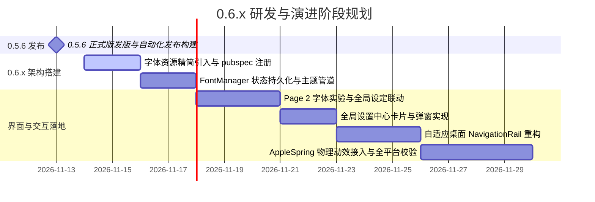

# 20261113.新版本 0.6.x 的字体和界面 UI 等等优化规划

## 1. 概述与演进背景

随着 `dart-flutter-demo` 完成桌面平台深度集成（Windows 跳转列表、缩略图工具栏、Linux MPRIS 媒体控件及多桌面环境系统通知等能力），应用已具备坚实的系统级底层支撑。
在进入 `0.6.x` 阶段时，应用将从“底层能力 PoC 验证”向“**极致视觉、优雅物理动效与现代跨端设计语言**”全面演进。

本轮规划通过深度解构业内两个高质量 Flutter 开源标杆——**Lazer**（音乐播放器）与 **FlClash**（代理工具客户端），梳理其 UI 架构、动效实现与字体系统工程化精髓，为 `dart-flutter-demo` 打造新一代的视觉与交互基石。

---

## 2. 标杆项目设计精髓深度剖析

### 2.1 Lazer（物理动效与字族工程化标杆）

1. **WWDC23 AppleSpring 弹簧物理引擎**：
   - Lazer 的路由过渡与模态弹窗摒弃了传统的固定贝塞尔曲线（如 `Curves.easeInOut`），采用苹果 WWDC23 弹簧模型（`lib/animation/apple_spring.dart`）。
   - 以感知响应时间（Perceived Duration）和弹性阻尼（Bounce）为核心参数，使得页面进出、抽屉滑动与卡片回弹具有接近 iOS / macOS 原生的温润手感。
2. **合成器保真视图切换（RetainedContentSwitcher）**：
   - 跨 Tab 或嵌套路由切换时，利用保留键机制维持底层 RenderObject，彻底消除布局重排引起的瞬时白屏或微小抖动。
3. **MiSans 全平台工程化实践**：
   - 原生构建嵌入高质量 MiSans（Regular、Medium、Semibold 等），建立完整的 `FontFamilyPreference` 抽象；
   - Web 构建搭配 `pyftsubset` 脚本裁剪常用字集（从 8MB/字重压缩至 2.3MB），平衡首屏加载性能与字形覆盖率。

### 2.2 FlClash（自适应桌面脚手架与设计令牌标杆）

1. **自适应跨端 Shell（Responsive Adaptive Scaffold）**：
   - 移动端采用标准底部 NavigationBar；
   - 桌面宽屏（宽视口 >= 768px）平滑展开为侧边栏 NavigationRail，并自动衔接窗体控制区域（TitleBar）。
2. **扁平化卡片式布局（Card-Grouped UI）**：
   - 统一使用 `Card` / `Container` 搭配微妙的边框描边（`Border.all` + 8~12% 不透明度）与轻量阴影（Elevation 0~1），层次清晰、拒绝视觉疲劳。
3. **状态感官微交互**：
   - 强调细微的状态变化动画，如悬停放大、轻微色调流转与平滑展开折叠。

---

## 3. 全局多字体切换系统调研与设计

### 3.1 霞鹜文楷（LXGW WenKai）生态与封装调研

在对 Flutter 生态与 pub.dev 的调研中发现：
1. **pub.dev 现状**：社区尚无官方或高活跃的独立独立 package（如 `lxgw_wenkai`）。
2. **Google Fonts 官方收录**：从 `google_fonts` 6.3.0 起，官方已正式收录 `lxgwWenKai` 与 `lxgwWenKaiTc`，可通过网络动态流式加载。但网络拉取存在弱网或无网络环境下首屏字体回退或加载延迟的问题。
3. **本地 Asset 现状**：本项目在 [`assets/fonts/LXGWWenKaiMono-Regular.ttf`](assets/fonts/LXGWWenKaiMono-Regular.ttf) 中已内置一份 24.7MB 的完整等宽单文件。

#### 方案选型评估：做成 Package 还是本地 Asset？
- **做成内部 Package（`packages/lxgw_fonts`）**：
  - *优点*：解耦主工程代码，资产结构干净。
  - *缺点*：中文字体通常为单文件二进制，做成插件包对本地编译和资源打包没有额外代码逻辑收益，反增依赖配置路径。
- **推荐策略（直接注册为本地 Asset，轻量直接）**：
  - 无需额外拆分 package，直接在主工程 `pubspec.yaml` 的 `flutter: fonts:` 节点正式声明家族名称 `'LXGW WenKai Mono'`。这样无论是普通桌面运行、打包发布还是 CI 构建均 100% 离线可用。

---

### 3.2 四大字体选项矩阵设计

新版将为用户提供 **4 种全局字体模式**，满足不同场景下的审美与实用诉求：

| 选项 ID | 显示名称 | 字体标识符 | 来源与引入策略 | 核心风格特征 |
|---|---|---|---|---|
| `miSans` | **小米 MiSans（推荐）** | `'MiSans'` | 借鉴 Lazer，按方案 B 仅引入 **Regular (400) + Medium/Semibold (600)** 核心字重（约 16MB） | 现代、中性、高清晰度屏显，排版规整 |
| `lxgwWenKai` | **霞鹜文楷等宽** | `'LXGW WenKai Mono'` | 启用仓库现有的 `assets/fonts/LXGWWenKaiMono-Regular.ttf` | 国风书法韵味、极客等宽质感 |
| `googleFonts` | **Google Fonts（在线精选）** | `GoogleFonts.inter` / `lato` 等 | 复用工程已有的 `google_fonts: ^6.1.0` 依赖 | 国际化无衬线西文字体，极简几何 |
| `system` | **系统原生默认** | `null` / 平台 Typography | Windows (`Segoe UI`), macOS/iOS (`.AppleSystemUIFont`), Linux (`Noto Sans`) | 零包体积增量，与宿主操作系统原生高度融合 |

---

### 3.3 交互承载设计：方案 C（设置中心 + Page 2 双向联动）

为了让字体切换既能在全局配置中直观掌控，又能在实验页中即时把玩，采用 **方案 C（A+B 结合）**：

```mermaid
flowchart TD
    subgraph UI_Surfaces["两大交互入口"]
        A["顶部/抽屉【⚙️ 设置】弹窗"] --> D["全局 AppFontManager"]
        B["【Page 2 文字排版工作室】"] --> D
    end

    subgraph State_Engine["状态与主题引擎"]
        D --> E["SharedPreferences 持久化记录"]
        D --> F["fontNotifier (ValueNotifier<AppFontFamily>)"]
        F --> G["MaterialApp ThemeData 动态重建"]
    end

    subgraph Visual_Impact["全应用瞬时生效"]
        G --> H["所有页面正文、标题与代码区动态重绘"]
        G --> I["Page 2 实验室实时展示字体字重渲染对比"]
    end
```

1. **全局设置面板（Settings Dialog / Sheet）**：
   - 卡片式单选列表，每个选项带有一个简短示例预览（如 `汉字排版 ABC 123`）；
   - 点击选项立即全局生效，并持久化到本地配置。
2. **Page 2 深度赋能**：
   - 现有的文字排版工作室作为“高阶调校场”，提供字号、字重、字间距、颜色微调；
   - 顶部增加醒目的【📌 设为全局字体】操作按钮，实现从“局部实验”到“全局应用”的一键流转。

---

## 4. UI 整体重构与动效升级规划

### 4.1 页面结构与导航升级
1. **响应式自适应布局**：
   - 在主窗口引入 Breakpoint 监控；宽屏时（宽度 >= 800dp）导航从底部 BottomNavigationBar 平滑变为左侧 NavigationRail。
2. **卡片视觉与色彩体系**：
   - 采用 Material 3 的 `colorSchemeSeed`，配合层次分明的 Card 背景与微妙边缘描边。

### 4.2 动效系统革新
1. **物理弹簧路由过渡（Spring Page Transitions）**：
   - 引入 Duration = 350ms、Bounce = 0.12 的平滑弹簧曲线，替代原生生硬的滑动。
2. **列表交错载入动效**：
   - 对 Page 0 系统信息卡片与 Page 3 自适应网格卡片增加微小的交错淡入平移动画（Staggered Fade-Slide）。

---

## 5. 路线演进与实施步骤

---

## 6. 风险控制与质量保证

1. **包体积控制**：
   - 严格落实方案 B（仅引入 MiSans 两个核心字重），避免打包产物无序膨胀；
   - 确保 release 构建在各平台打包后增量可控。
2. **跨平台兼容测试**：
   - 验证字体在 Windows ClearType、Linux FreeType、macOS Retina 及 Android/iOS 上的垂直对齐度（Baseline alignment）与中英文混排间距。
3. **CI 质量门约束**：
   - 继续保留并扩充单元测试，覆盖 `FontManager` 的状态恢复、无效字体回退机制与主题生成稳定性。
